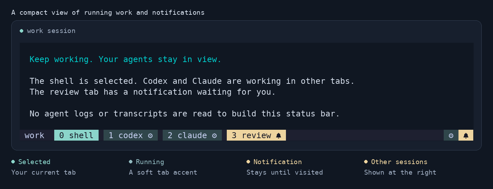
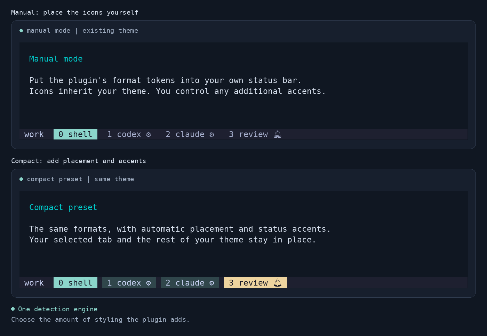
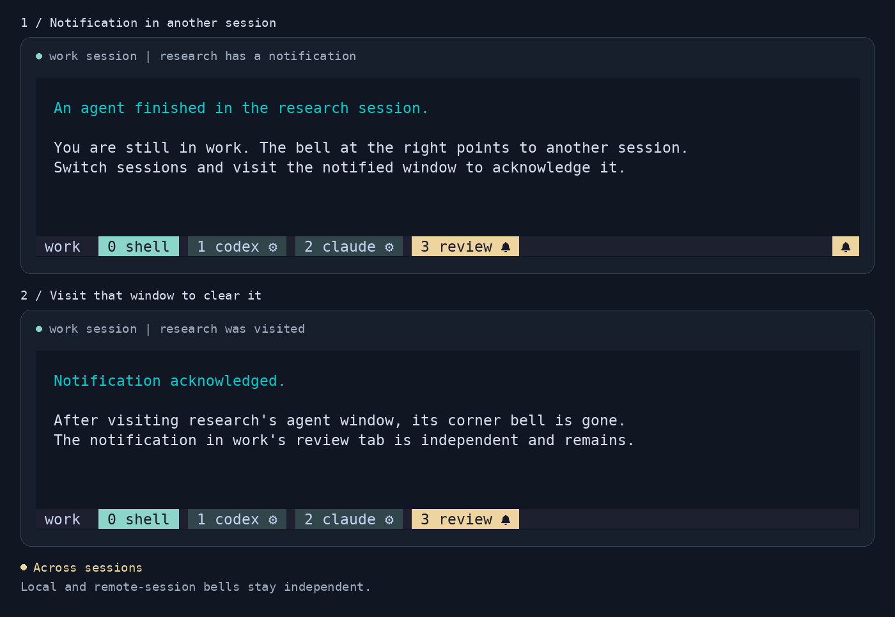

# tmux-agent-status

**Know which agent tabs are working—and which need your attention.**

Compact activity and notification indicators for tmux. Keep your theme, keep
working in another session, and come back when a tab has something for you.

[](https://github.com/benremer/tmux-agent-status/actions/workflows/test.yml)
[](LICENSE)
[](CHANGELOG.md)



[Install](#install) · [Set up your agent](#set-up-your-agent) ·
[Choose your layout](#choose-your-layout) · [Options](#options) ·
[Troubleshooting](docs/TROUBLESHOOTING.md)

| Indicator | Meaning |
|---|---|
| ⚙ | An agent is working. The compact preset adds a soft tab accent. |
| 🔔 | A window has an unread terminal bell. Visit that window to acknowledge it. |
| Corner ⚙ / 🔔 | Work or notifications exist in another session on this tmux server. |
| No icon | No work or notification to show. |

A bell takes priority over the running icon on a tab. Both can appear in the
corner. Your selected tab keeps its normal highlight while working.

No daemon, transcript scraping, model requests, or shell polling during status
refreshes. The core uses native tmux formats; optional adapters report Claude
turn events or Antigravity's activity title.

> **Beta:** tmux 3.4+ is required. Linux is locally verified; macOS is locally
> verified for unreleased changes, and hosted macOS CI is pending. See the precise
> [compatibility and validation record](validation.md).

## Install

### With TPM

Add these **before** your existing TPM initialization line, after any theme
plugin entries:

```tmux
set -g @plugin 'benremer/tmux-agent-status'
set -g @agent-status-preset 'compact'
set -g monitor-bell on
set -g bell-action any
```

Press **prefix + I** to install with [TPM](https://github.com/tmux-plugins/tpm).
Then [set up your agent](#set-up-your-agent). Do not also add a manual
`run-shell` load when using TPM.

### Without TPM

```sh
git clone --branch v0.1.0-beta.2 \
  https://github.com/benremer/tmux-agent-status.git \
  ~/.tmux/plugins/tmux-agent-status
```

Add this near the end of `~/.tmux.conf`, after your theme:

```tmux
set -g @agent-status-preset 'compact'
set -g monitor-bell on
set -g bell-action any
run-shell '~/.tmux/plugins/tmux-agent-status/agent-status.tmux'
```

Reload with `tmux source-file ~/.tmux.conf`, then set up your agent below.
Existing sessions can stay running.

## Set up your agent

### Codex

Merge these settings into the existing `[tui]` section of your Codex config
(normally `~/.codex/config.toml`):

```toml
[tui]
notifications = true
notification_method = "bel"
notification_condition = "always"
```

Keep activity in Codex's terminal title. Its default title includes `activity`;
if you customize title items, retain it. The plugin recognizes Codex's busy
spinner and becomes idle when the spinner disappears. Restart/resume Codex
after changing its config.

The settings above are present in the public Codex 0.166.0
[configuration schema](https://github.com/openai/codex/blob/rust-v0.166.0/codex-rs/core/config.schema.json).

### Claude Code

Recent Claude versions keep a static title inside tmux. Use the included
adapter to report actual turn activity:

```sh
mkdir -p ~/.claude/skills
ln -s ~/.tmux/plugins/tmux-agent-status/adapters/claude \
  ~/.claude/skills/tmux-agent-status
```

If that destination already exists, inspect it instead of overwriting it.
Merge this into `~/.claude/settings.json`:

```json
{
  "preferredNotifChannel": "terminal_bell"
}
```

Restart/resume Claude. The adapter sends a notification when the main turn
finishes; cancellation and subagent completion do not ring. It does nothing
outside an interactive tmux session. Claude may show its normal plugin trust
prompt.

The adapter is tested with **public Claude Code 2.1.314**. See
[adapter details](adapters/claude/README.md) for one-session loading, behavior,
and uninstall instructions. Earlier versions without mods support cannot
load this adapter.

### Antigravity (`agy`)

`agy` is recognized by default. Install the
[optional title adapter](adapters/antigravity/README.md) to publish its working
state. Without a title command, bells can work while the running cog stays
absent. The adapter is currently available on the `dev` branch, after beta.2;
it is not included in the beta.2 archive.

Enable `"notifications": true` in `~/.gemini/antigravity-cli/settings.json`
for terminal bells, as described in its
[configuration reference](https://antigravity.google/docs/cli/reference/).
Live Antigravity activity detection has not yet been verified.

### Other agents

Names and title patterns are configurable. For example:

```tmux
set -g @agent-status-command-pattern '^(codex|claude|agy|my-agent)$'
```

A matching name alone does not mean an agent is working. It also needs a
matching busy title or an integration that reports activity. See the
[adapter contract](docs/CONFIGURATION.md#reporting-activity-from-another-agent).
Terminal-bell notifications work independently of agent recognition.

## Choose your layout

Use the **compact preset** for automatic placement and color accents. Use
**manual mode** to insert indicators into an existing status layout.



### Compact preset

```tmux
set -g @agent-status-preset 'compact'
```

It decorates your window formats and appends other-session indicators to
`status-right`. It preserves names, theme styling, key bindings, and existing
status content. Repeated loads do not duplicate its additions.

The preset supports tmux's standard status layout. For a custom
`status-format`, use manual placement.

### Manual mode

```tmux
set -g @agent-status-preset 'none'
```

Insert these tokens into your existing formats:

| Where | Token |
|---|---|
| Window tabs | `#{E:@agent-status-window}` |
| Session picker | `#{E:@agent-status-session}` |
| Corner / other sessions | `#{E:@agent-status-other}` |

For a minimal fresh layout:

```tmux
set -g window-status-format ' #I #W#{E:@agent-status-window} '
set -g window-status-current-format ' #I #W#{E:@agent-status-window} '
set -g status-right '#{E:@agent-status-other}'
```

For an existing layout, insert the tokens rather than replacing whole lines.
Tokens include spacing and are empty when idle.
[Manual accents](examples/dark-theme.conf) and a
[session-picker example](examples/session-picker.conf) are included.

## Across sessions

A notification in a different session appears in your current session's corner.
Visiting the notified window acknowledges it; unrelated bells remain.



These are native **window-level** bells. Any application can ring one. Another
client viewing the same window may acknowledge it too. A bell in the window
you are already viewing need not leave an unread marker. Ordinary SSH
disconnects preserve tmux's state; restarting the tmux server does not.

Try the bell path without an agent:

```sh
sleep 3; printf '\a'
```

Switch to another window or session before it rings. The indicator should
appear by the next status refresh. More output from the original pane must
not clear it.

## Options

Set options before the plugin loads, then reload to apply them.

| Option | Default |
|---|---|
| `@agent-status-preset` | `none`; opt into `compact` |
| `@agent-status-running-icon` | `⚙` |
| `@agent-status-bell-icon` | `🔔` |
| `@agent-status-command-pattern` | `^(codex\|claude\|agy)$` |
| `@agent-status-agent-title-pattern` | `^✳ ` |
| `@agent-status-busy-title-pattern` | Braille spinner followed by a space |
| `@agent-status-running-style` | Inherit in manual mode; soft teal in compact mode |
| `@agent-status-bell-style` | Inherit in manual mode; amber in compact mode |

For example:

```tmux
set -g @agent-status-running-icon '*'
set -g @agent-status-bell-icon '!'
set -g @agent-status-running-style 'bg=#30464b,fg=#cad3f5'
set -g @agent-status-bell-style 'bg=#eed49f,fg=#181926,bold'
```

See [configuration details](docs/CONFIGURATION.md) for numeric state formats,
empty overrides, and integration rules.

## Upgrade or uninstall

Upgrade TPM installations with **prefix + U**. For a manual checkout, fetch
tags and check out the desired release, then reload your tmux config. Read the
[changelog](CHANGELOG.md) before upgrading a beta.

To remove preset styling, set `@agent-status-preset 'none'` and reload **while
the plugin is still installed**. Then remove its load entry and any manually
inserted tokens. If installed, remove the Claude adapter symlink and restart
Claude too. Do not kill your tmux server to uninstall.

## Help and contributions

- [Troubleshooting](docs/TROUBLESHOOTING.md): missing bells, title detection,
  themes, nested tmux, and terminal flashes.
- [Validation record](validation.md): tested versions and known limitations.
- [Contributing](CONTRIBUTING.md): local tests and bug-report details.
- [Report an issue](https://github.com/benremer/tmux-agent-status/issues).

The images show real output from an isolated demo server, with explanatory
captions and a sample base theme. [Image source and regeneration](docs/images/README.md).

Licensed under [MIT](LICENSE). Use it, modify it, and share it.
