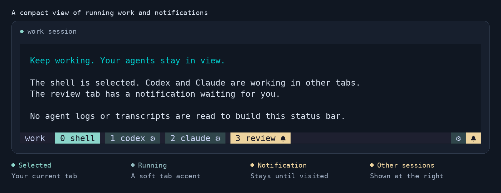
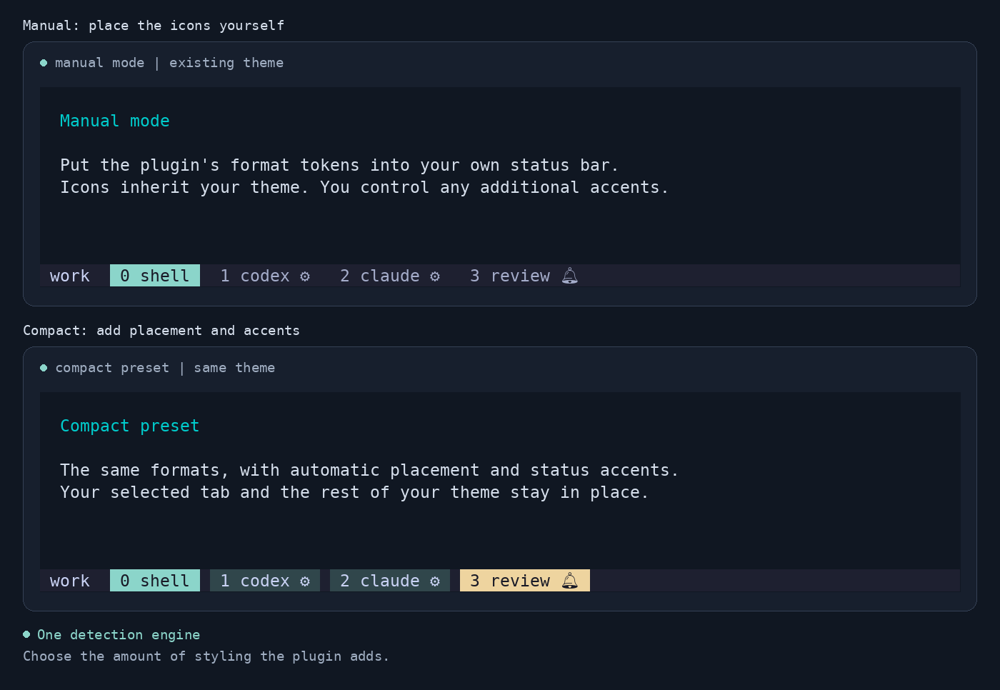
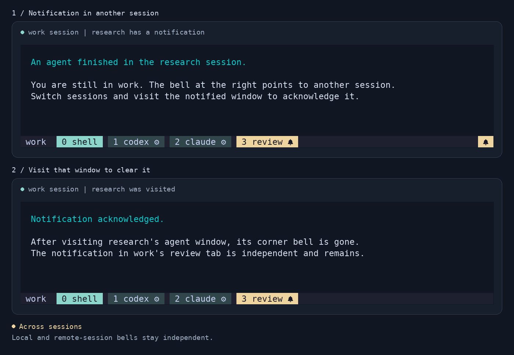

# tmux-agent-status

**Know which agent tabs are working—and which need your attention.**

Compact activity and notification indicators for tmux. Keep your theme, keep
working in another session, and come back when a tab has something for you.

[](https://github.com/benremer/tmux-agent-status/actions/workflows/test.yml)
[](LICENSE)
[](CHANGELOG.md)



[Install](#install) · [Set up your agent](#set-up-your-agent) ·
[Choose your layout](#choose-your-layout) · [Options](#options) ·
[Troubleshooting](docs/TROUBLESHOOTING.md)

| Indicator | Meaning |
|---|---|
| ⚙ | An agent is working. The compact preset adds a soft tab accent. |
|  | A window has an unread terminal bell. Visit that window to acknowledge it. |
| Corner ⚙ /  | Work or notifications exist in another session on this tmux server. |
| Broken link (stale) | An SSH tab's [remote tmux](#remote-tmux-over-ssh) stopped reporting. |
| No icon | No work or notification to show. |

The bell is a [Nerd Font](https://www.nerdfonts.com/) glyph, sized like the
cog. If your terminal font is not a Nerd Font and the bell shows as a box, set
`@agent-status-icons 'emoji'` to use 🔔 instead.

A bell takes priority over the running icon on a tab. Both can appear in the
corner. Your selected tab keeps its normal highlight while working.

No daemon, transcript scraping, model requests, or shell polling during status
refreshes. The core uses native tmux formats; optional adapters report Claude
turn events or Antigravity's activity title.

Requires **tmux 3.4+**, on Linux or macOS. This is a beta: options may still
change between releases.

## Install

### With TPM

Add these **before** your existing TPM initialization line, after any theme
plugin entries:

```tmux
set -g @plugin 'benremer/tmux-agent-status'
set -g @agent-status-preset 'compact'
set -g monitor-bell on
set -g bell-action any
```

Press **prefix + I** to install with [TPM](https://github.com/tmux-plugins/tpm).
Then [set up your agent](#set-up-your-agent). Do not also add a manual
`run-shell` load when using TPM.

### Without TPM

```sh
git clone --branch v0.1.0-beta.2 \
  https://github.com/benremer/tmux-agent-status.git \
  ~/.tmux/plugins/tmux-agent-status
```

Add this near the end of `~/.tmux.conf`, after your theme:

```tmux
set -g @agent-status-preset 'compact'
set -g monitor-bell on
set -g bell-action any
run-shell '~/.tmux/plugins/tmux-agent-status/agent-status.tmux'
```

Reload with `tmux source-file ~/.tmux.conf`, then set up your agent below.
Existing sessions can stay running.

## Set up your agent

| Agent | Running cog | Completion bell |
|---|---|---|
| Codex | No setup | No setup |
| Claude Code | Install the adapter | Install the adapter; `terminal_bell` recommended |
| Antigravity (`agy`) | Install the title adapter | Included with the title adapter |
| Other agents | A busy title or an adapter | Included with a busy title |
| Agents in a [remote tmux over SSH](#remote-tmux-over-ssh) | One option on the remote | Included |

For agents that show a spinner in their terminal title, the plugin rings the
tab's bell itself when the spinner goes away. That is the
[completion bell](#completion-bell), and it needs no agent configuration.

### Codex

Nothing to set up. Codex's default terminal title includes `activity`, and the
plugin uses its busy spinner for both the running cog and the completion bell.
If you customize Codex's title items, keep `activity`.

You no longer need Codex's own `notification_method = "bel"`. If you already
set it, Codex and the plugin may both ring at the end of a turn. Turn off one
of them: remove the Codex setting, or set `@agent-status-completion-bell off`.

### Claude Code

Claude needs the included adapter for **both** indicators. Recent Claude
versions keep a static title inside tmux, so the cog has nothing to match
without it. And Claude's default notification channel (`auto`) sends nothing
inside tmux, so without it a finished turn rings no bell either.

**1. Install the adapter.** Link it into Claude's skills directory:

```sh
mkdir -p ~/.claude/skills
ln -s ~/.tmux/plugins/tmux-agent-status/adapters/claude \
  ~/.claude/skills/tmux-agent-status
```

If that destination already exists, inspect it instead of overwriting it.
Restart/resume Claude. It may show its normal plugin trust prompt.

The adapter shows the cog while the main turn runs. It rings the bell when the
main turn finishes. Cancellation and subagent completion do not ring. It does
nothing outside an interactive tmux session.

**2. Recommended: set Claude's notification channel to the terminal bell.**
Merge this into `~/.claude/settings.json`, or pick **Terminal Bell** for the
notifications row in `/config`:

```json
{
  "preferredNotifChannel": "terminal_bell"
}
```

This setting decides how the bell reaches tmux:

| `preferredNotifChannel` | Completion bell in tmux |
|---|---|
| `terminal_bell` or `iterm2_with_bell` | Claude rings it. This also covers Claude's own notifications, such as permission prompts and idle input. |
| `auto` (default) | No channel works inside tmux, so the adapter rings the pane's bell itself. You get completion bells only. |
| `iterm2`, `kitty`, `ghostty` | Claude sends its desktop notification. These do not set tmux's bell flag, so the adapter also rings the pane's bell. |
| `notifications_disabled` | No bell. The adapter respects this. |

Without `terminal_bell`, Claude's own notifications never reach tmux. For
example, a tab waiting on a permission prompt gets no bell. The adapter only
covers turn completion, so set `terminal_bell` to get both.

The adapter needs a Claude Code version with mods support (2.1.314 or later).
See [adapter details](adapters/claude/README.md) for one-session loading,
behavior, and uninstall instructions.

### Antigravity (`agy`)

`agy` is recognized by default, but its title is static until you configure a
title command. Install the
[title adapter](adapters/antigravity/README.md). It shows a spinner while agy
works, which gives you both the running cog and the completion bell. You don't
need agy's `"notifications": true` for tmux. Antigravity support is new and
less tested than Codex and Claude.

### Other agents

Names and title patterns are configurable. For example:

```tmux
set -g @agent-status-command-pattern '^(codex|claude|agy|my-agent)$'
```

A matching name alone does not mean an agent is working. It also needs a
matching busy title or an integration that reports activity. See the
[adapter contract](docs/CONFIGURATION.md#reporting-activity-from-another-agent).
A matching busy title also gives the agent the completion bell. Bells the
agent rings itself work independently of agent recognition.

### Completion bell

When a recognized agent's title changes from busy (a spinner) to idle, the
plugin rings that pane's bell. It is a normal tmux bell, so it marks the tab
and the corner indicator like any other. It does not ring while you are
viewing the window. A new spinner frame never rings, and a shell's title
change after the agent exits doesn't either. tmux runs a shell command only
once per finished turn, not for every title change.

Turn it off with `set -g @agent-status-completion-bell off`, for example if
your agent already rings its own bell at completion. Claude's adapter rings
its own bell, so this setting does not affect Claude.

### Remote tmux over SSH

If your agents run in a tmux on another machine, the SSH tab on your local
tmux can show them like local agents. Install the plugin on both machines,
and turn on the relay **on the remote**:

```tmux
set -g @agent-status-relay on
```

The local side needs nothing. The SSH tab then stands for the whole remote
tmux, every session included:

- While any remote agent is busy, it gets the running cog and accent.
- While any remote window has an unread bell, it shows the bell. That bell
  clears when you view the window on the remote, not when you open the SSH
  tab.
- Your other local sessions see both in the corner.

The remote publishes `agents BUSY/TOTAL !BELLS ~TIME` in its terminal title. That
needs a `status-interval` between 1 and 15 on the remote. Without agents, it
uses your own `set-titles-string`. Your local tmux reads the title from any
pane running `ssh`, `mosh-client`, or `et`. If the title is more than 30
seconds old, the tab shows the stale icon, a broken link (U+F127), instead of
the cog. That usually means a hung connection.

A tab shows one icon: an unread bell, otherwise stale, otherwise running. To
also show how many remote agents are busy (`⚙ 2/3`):

```tmux
set -g @agent-status-relay-count on
```

Set this one on your local tmux.

## Choose your layout

Use the **compact preset** for automatic placement and color accents. Use
**manual mode** to insert indicators into an existing status layout.



### Compact preset

```tmux
set -g @agent-status-preset 'compact'
```

It decorates your window formats and appends other-session indicators to
`status-right`. It preserves names, theme styling, key bindings, and existing
status content. Repeated loads do not duplicate its additions.

The preset supports tmux's standard status layout. For a custom
`status-format`, use manual placement.

### Manual mode

```tmux
set -g @agent-status-preset 'none'
```

Insert these tokens into your existing formats:

| Where | Token |
|---|---|
| Window tabs | `#{E:@agent-status-window}` |
| Session picker | `#{E:@agent-status-session}` |
| Corner / other sessions | `#{E:@agent-status-other}` |

For a minimal fresh layout:

```tmux
set -g window-status-format ' #I #W#{E:@agent-status-window} '
set -g window-status-current-format ' #I #W#{E:@agent-status-window} '
set -g status-right '#{E:@agent-status-other}'
```

For an existing layout, insert the tokens rather than replacing whole lines.
Tokens include spacing and are empty when idle.
[Manual accents](examples/dark-theme.conf) and a
[session-picker example](examples/session-picker.conf) are included.

## Across sessions

A notification in a different session appears in your current session's corner.
Visiting the notified window acknowledges it; unrelated bells remain.



These are native **window-level** bells. Any application can ring one. Another
client viewing the same window may acknowledge it too. A bell in the window
you are already viewing need not leave an unread marker. Ordinary SSH
disconnects preserve tmux's state; restarting the tmux server does not.

Try the bell path without an agent:

```sh
sleep 3; printf '\a'
```

Switch to another window or session before it rings. The indicator should
appear by the next status refresh. More output from the original pane must
not clear it.

## Options

Set options before the plugin loads, then reload to apply them.

| Option | Default |
|---|---|
| `@agent-status-preset` | `none`; opt into `compact` |
| `@agent-status-icons` | `nerd-font` (⚙ and the Nerd Font bell ); `emoji` uses ⚙ and 🔔 |
| `@agent-status-running-icon` | From `@agent-status-icons` |
| `@agent-status-bell-icon` | From `@agent-status-icons` |
| `@agent-status-command-pattern` | `^(codex\|claude\|agy)$` |
| `@agent-status-agent-title-pattern` | `^✳ ` |
| `@agent-status-busy-title-pattern` | Braille spinner followed by a space |
| `@agent-status-running-style` | Inherit in manual mode; soft teal in compact mode |
| `@agent-status-bell-style` | Inherit in manual mode; amber in compact mode |
| `@agent-status-completion-bell` | `on`; rings a tab's bell when its agent's busy title turns idle |
| `@agent-status-stale-icon` | From `@agent-status-icons`: a broken link (U+F127, `nf-fa-chain_broken`), or ⚠ for `emoji` |
| `@agent-status-stale-style` | Inherit in manual mode; muted red in compact mode |
| `@agent-status-relay` | `off`; on a remote tmux, publish its agents to the local tmux over SSH |
| `@agent-status-relay-count` | `off`; show remote busy/total counts next to the cog |
| `@agent-status-relay-command-pattern` | `^(ssh\|mosh-client\|et)$`; panes whose title may carry a relay |

For example:

```tmux
set -g @agent-status-running-icon '*'
set -g @agent-status-bell-icon '!'
set -g @agent-status-running-style 'bg=#30464b,fg=#cad3f5'
set -g @agent-status-bell-style 'bg=#eed49f,fg=#181926,bold'
```

Without a Nerd Font, use `set -g @agent-status-icons 'emoji'`. tmux cannot
detect the terminal's font, so the plugin cannot choose this automatically.

See [configuration details](docs/CONFIGURATION.md) for numeric state formats,
empty overrides, and integration rules.

## Upgrade or uninstall

Upgrade TPM installations with **prefix + U**. For a manual checkout, fetch
tags and check out the desired release, then reload your tmux config. Read the
[changelog](CHANGELOG.md) before upgrading a beta.

To uninstall, run this **while the plugin is still installed**:

```sh
tmux run-shell '~/.tmux/plugins/tmux-agent-status/agent-status.tmux --uninstall'
```

It restores your window and status formats and removes the completion-bell
hook and every `@agent-status-*` option, without restarting tmux. Then remove
the plugin's lines from `~/.tmux.conf`, plus any tokens you placed manually.
If you installed the Claude adapter, remove its symlink and restart Claude.

To keep the plugin but drop only the preset styling, set
`@agent-status-preset 'none'` and reload.

## Help

[Troubleshooting](docs/TROUBLESHOOTING.md) covers missing bells, title
detection, themes, nested tmux, terminal flashes, and known limitations.
Found a bug? [Open an issue](https://github.com/benremer/tmux-agent-status/issues).

## Development

The core is POSIX shell and tmux formats. The tests start disposable tmux
servers and never touch yours:

```sh
shellcheck -x -s sh agent-status.tmux scripts/preset.sh
python3 tests/integration.py         # TMUX_BIN=/path/to/tmux to pick a build
python3 tools/check_docs.py          # versions and local doc links
claude plugin test adapters/claude   # Claude adapter event tests
```

`tests/benchmark.py` measures format latency and server CPU with many busy
agents. The screenshots are rendered from a real tmux server; see
[docs/images](docs/images/README.md) to regenerate them.

Licensed under [MIT](LICENSE).
